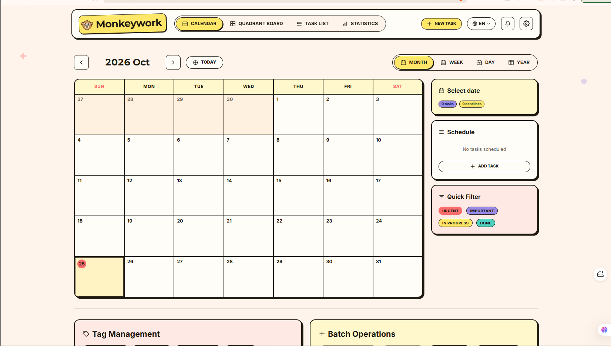

<div align="center">


# Monkeywork

### *Eisenhower Matrix · Calendar · Task List — all in one.*

**A cute cartoon-style Eisenhower Matrix task scheduler PWA — React 19 + SQLite WASM, fully offline-ready.**

[](https://react.dev)
[](https://www.typescriptlang.org)
[](https://vite.dev)
[](https://sqlite.org)
[](https://developer.mozilla.org/en-US/docs/Web/Progressive_web_apps)
[](#license)

**English** &nbsp;|&nbsp; [Русский](README.ru.md)

</div>

---

## Screenshot

<p align="center">
  
</p>

---

## Features

| Capability | Description |
|---|---|
| Calendar | Month / Week / Day / Year views with a task schedule sidebar |
| Quadrant Board | Eisenhower Matrix with drag-and-drop task classification |
| Tag System | Preset tags + custom color labels |
| AI Channel | Built-in JSON-RPC 2.0 API via `window.__MonkeyworkAI` and `postMessage` |
| Notifications | In-app + desktop push + deadline reminders + Webhook push |
| Excel | CSV / Excel import & export, downloadable template |
| Statistics | Quadrant distribution and completion charts |
| Offline | All data lives in your browser (OPFS, SQLite WASM) — no server |
| Languages | Russian (default) and English, switcher in the header |

## Quick Start

```bash
pnpm install
pnpm dev        # http://localhost:5173
```

## Commands

| Command | Description |
|---|---|
| `pnpm dev` | local development |
| `pnpm build` | TypeScript check + production build |
| `pnpm preview` | preview the production build |
| `pnpm lint` | Biome check |
| `pnpm icons` | regenerate PWA icons from the logo (`scripts/generate-icons.mjs`) |

## Deployment

A pure static build — runs on any static host with zero server configuration.

| Host | How |
|---|---|
| **GitHub Pages** | push to `main` — the `.github/workflows/deploy.yml` workflow (base path `/monkeywork/`) |
| **Cloudflare Pages** | `deploy-cf.yml` workflow (requires a `CLOUDFLARE_API_TOKEN` secret) or `wrangler pages deploy dist` |
| **Vercel** | Framework: **Vite**, build `pnpm build`, output `dist` |
| **Docker** | `docker build -t monkeywork -f docs/deploy/Dockerfile . && docker run -d -p 8080:80 monkeywork` |

## AI API

A built-in JSON-RPC 2.0 interface for AI agents: read and write task data through
`window.__MonkeyworkAI` or `postMessage`. Permissions are tiered as `readonly` and `readwrite`.
See [docs/ai-api.md](docs/ai-api.md) for the full reference.

```js
const api = window.__MonkeyworkAI;
const tasks = await api.queryTasks({ status: "todo" });
await api.createTask({ title: "New task", priority: "urgent-important" });
```

## Tech Stack

React 19 · TypeScript 6 · Vite 8 · Tailwind CSS 4 · Zustand 5 · SQLite WASM (OPFS) · date-fns · Biome

## License

[MIT](LICENSE) — based on [duckly](https://github.com/niyongsheng/duckly) by niyongsheng.
